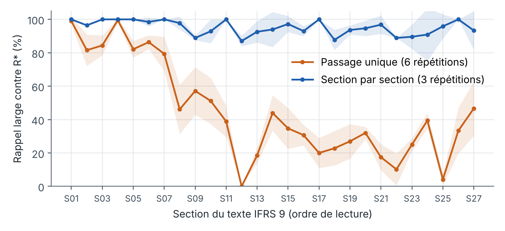
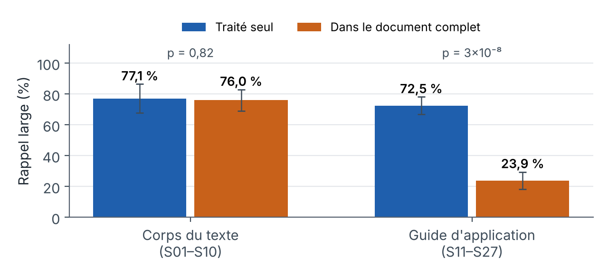
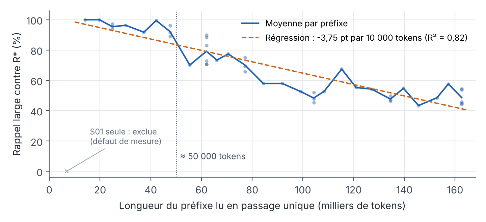
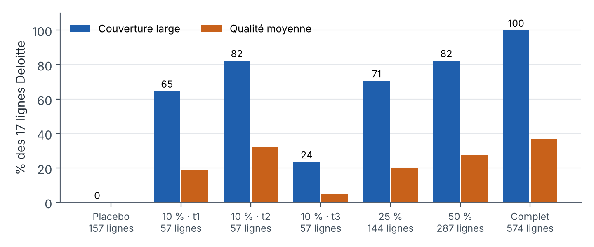

# Agent de conformité réglementaire — mesurer l'essoufflement d'un LLM sur un long texte

Projet réalisé dans le cadre du Master 2 ESA (Économétrie et Statistiques Appliquées) — Université d'Orléans, année universitaire 2026-2027, **en partenariat avec Deloitte** (Risk Advisory, Intelligence & Data).

Équipe : Quentin RUEL, Olivier BAUDOUIN, Sidi Abdellah MOHAMED ABDERRAHMANE.

> ⚠️ **Version publique.** Les référentiels de contrôle fournis par Deloitte sont confidentiels et le texte de la norme IFRS 9 n'est pas librement redistribuable : aucun des deux ne figure ici, pas plus que les sorties qui en citent des extraits. Le code, les prompts, les tests, les résultats agrégés et le rapport sont fournis à titre de démonstration technique. Le projet ne peut pas être relancé tel quel sans ces données ni sans clé API.

---

## 📌 Présentation

Si l'on donne à un modèle de langage un texte réglementaire de 150 pages en entier, sait-il en tirer un référentiel de contrôle aussi complet à la fin qu'au début ? L'hypothèse de départ, la « théorie de l'essoufflement », dit que non. Le projet consiste à **mesurer cet essoufflement**, puis à **concevoir une architecture qui le contourne**, sans renoncer à garder le document entier dans le contexte du modèle (approche CAG, *Context Augmented Generation*, sans moteur de recherche).

Deux agents :

- **Agent 1, le générateur** : il lit le texte et produit un référentiel structuré d'obligations, de contrôles clés et de tests de conformité. Chaque ligne cite mot pour mot le passage qui la fonde.
- **Agent 2, l'évaluateur** : il confronte ce référentiel à celui d'experts (Deloitte) et mesure la couverture, la qualité de la couverture et les écarts.

Le même code et les mêmes prompts sont appliqués à deux textes très différents : **IFRS 9** (norme comptable, anglais, ≈ 163 000 tokens) et la **loi Sapin 2** (anticorruption, français, ≈ 60 000 tokens).

---

## 🛠️ Stack technique

| Composant | Outil |
|---|---|
| Modèle de langage | Claude Sonnet, via le SDK `anthropic` (prompt caching, API Batch, sorties structurées) |
| Orchestration | LangGraph |
| Schéma de sortie | Pydantic |
| Observabilité | LangSmith (métadonnées seules) et journal des coûts local |
| Lecture des PDF | PyMuPDF |
| Tableau de bord | Streamlit |
| Tests | pytest (aucun appel API) |
| Langage | Python 3.14 |

---

## ⚙️ Démarche et fonctionnalités clés

- **Deux modes d'exécution comparés** : un *passage unique* (témoin : tout le document, une seule consigne) et un mode *section par section* (traitement : le document entier reste en cache, seule la consigne change, « traite la section X »).
- **Découpage générique** du document à partir de sa structure (titres, numérotation), sans rien de spécifique à un texte.
- **« La règle décide, le LLM extrait »** : tout ce qui peut être vérifié mécaniquement l'est sans LLM. Les citations sont contrôlées par recherche de chaîne dans le texte source, ce qui donne un taux d'hallucination déterministe.
- **Passe de rattrapage** : une règle repère les paragraphes prescriptifs restés sans ligne, et le LLM les ré-extrait.
- **Évaluation par un juge LLM** encadré par une règle d'appariement écrite, avec des **tests placebo** pour vérifier que le juge n'est pas complaisant.
- **Démarche expérimentale** : répétitions, tests de Welch, régressions du rappel sur la position et sur la longueur, reproductibilité mesurée par l'indice de Jaccard.
- **Maîtrise des coûts** : cache de prompt, traitement par lots (batch), cache disque, journal comptable et garde-fou budgétaire. Coût total du projet : 53 $.
- **Prompts versionnés** (v1 à v4b), dont la version est journalisée avec chaque run.

---

## 📊 Principaux résultats

| Indicateur | Résultat |
|---|---|
| Rappel sur IFRS 9, passage unique → section par section | 50 % → 95 % |
| Pente de position (début → fin du texte) | −0,888 → −0,072, soit −92 % |
| Même contenu, lu seul ou placé en fin de document | 72,5 % contre 23,9 % (p = 3×10⁻⁸) |
| Reproductibilité (Jaccard moyen entre répétitions) | 0,72 → 0,90 |
| Couverture large du référentiel d'experts, IFRS 9 / Sapin 2 | 94–100 % / 88–96 % |
| Citations introuvables dans le texte source | 0,7 % (IFRS 9) |



En passage unique, le modèle restitue bien les premières sections puis décroche. Section par section, la courbe reste plate.



L'expérience décisive : la seconde moitié d'IFRS 9 est retrouvée à 72,5 % quand elle est lue seule, et à 23,9 % quand elle arrive après la première. Ce n'est pas la difficulté du contenu, c'est ce qui le précède.



Sur IFRS 9 lu depuis le début, le rappel reste au-dessus de 90 % jusqu'à environ 50 000 tokens, puis décroît.



Un référentiel placebo obtient 0 % de couverture, et la couverture augmente avec la part du référentiel réel fournie : le juge n'est pas complaisant.

**Limite principale** : au sens large, l'agent couvre la quasi-totalité des référentiels d'experts, mais il reproduit rarement leurs lignes au même niveau de détail (qualité moyenne de 37 % sur IFRS 9 et 52 % sur Sapin 2). Le rapport détaille cette limite et les autres.

Le rapport complet est disponible ici : [rapport_agent_conformite.pdf](rapport_agent_conformite.pdf).

---

## 📁 Structure du dossier

```
├── app_streamlit.py        # Tableau de bord Streamlit (7 onglets)
├── Makefile                # setup, test, run
├── requirements.txt        # Dépendances, versions figées
├── .env.example            # Variables attendues (sans valeurs)
├── src/
│   ├── prompts/            # Prompts versionnés (.txt)
│   ├── decoupage.py        # Découpage générique en sections
│   ├── extraction.py       # Agent 1 : extraction
│   ├── rattrapage.py       # Passe de rattrapage
│   ├── dedoublonnage.py    # Dédoublonnage par paires
│   ├── enrichissement.py   # Agent 1 : contrôle clé et test de conformité
│   ├── verif_citations.py  # Vérification déterministe des citations
│   ├── agent2.py           # Agent 2 : juge et métriques de couverture
│   ├── metriques.py        # Rappel, précision, F1, Jaccard, régressions
│   ├── pipeline.py         # Graphe LangGraph
│   ├── couts.py            # Journal des coûts et garde-fou budgétaire
│   └── …
├── scripts/                # Points d'entrée en ligne de commande
├── tests/                  # Tests pytest sur données factices
├── docs/                   # Règle d'appariement, notes sur les corpus
├── resultats_agreges/      # Métriques agrégées (sans texte source ni référentiel)
├── figures/
└── rapport_agent_conformite.pdf
```

---

## 🔁 Relancer le projet

Les tests unitaires tournent sans clé API ni données :

```bash
make setup     # crée l'environnement virtuel et installe les dépendances
make test      # lance les tests (aucun appel API)
```

Relancer les agents demande une clé API Anthropic (à placer dans un fichier `.env`, voir `.env.example`), le texte réglementaire au format PDF et, pour l'évaluation, un référentiel de contrôle au format Excel. Chaque script payant dispose d'une option `--simulation` qui chiffre l'opération avant de l'exécuter.
